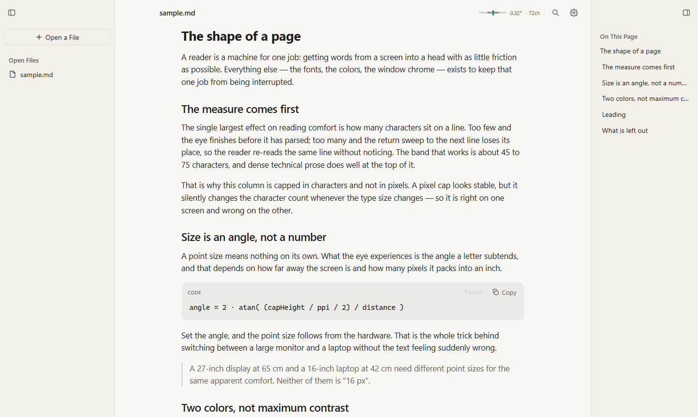

# Muo

A markdown reader that sizes type from your screen and your viewing distance, then
holds the line at 72 characters.



## The idea

A point size means nothing on its own. What your eye sees is the angle a letter
covers, and that depends on how far away the screen is and how many pixels it packs
into an inch. Muo measures the display, takes your distance from it, and solves for
the size:

```
angle = 2 · atan( (capHeight / ppi / 2) / distance )
```

A 27-inch display at 65 cm and a 16-inch laptop at 42 cm need different point sizes
for the same apparent comfort. Neither of them is 16 px.

The column is capped in characters, not pixels. A pixel cap looks stable, but it
silently changes the character count whenever the type size changes, so it is right
on one screen and wrong on the other.

## What it does

- **Three panes.** Files, page, and the document's own headings. Every divider drags.
  Every pane folds away and comes back where you left it.
- **Find that marks the page.** Every match is highlighted where it sits, headings
  included. Enter walks them.
- **PDF search.** Find reads the page text and turns to the page the match is on.
- **Code you can tidy.** Go and JSON go through the standard library. Other languages
  get spacing and indentation that never reaches inside a string or a comment.
- **It remembers.** Your place in each document, pane widths, which panes you folded,
  and the files you had open.
- **One dependency.** Go, drawn on the GPU by [MyGo](https://github.com/egoist/mygo).
  No webview, no JavaScript runtime, no frontend build.

## Build

You need Go 1.24 or newer.

```sh
git clone https://github.com/yaffalhakim1/muo
cd muo
go build -o muo .
./muo sample.md
```

On Windows the binary is `muo.exe`.

For live reload while you edit:

```sh
go run github.com/egoist/mygo/cmd/mygo@v0.6.3 dev .
```

That rebuilds and restarts the window when a Go file changes.

## Layout

```
muo/
├── pdf/       the PDF parser, interpreter and rasterizer, with no dependency on the app
├── code/      the code formatter and tab expansion
└── *.go       the reader: frame, settings, theme, outline, find
```

`pdf` and `code` build standalone. The app imports them and nothing else.

## Tests

```sh
go test ./...
```

99 tests. They drive the window headlessly through MyGo's tester, so what is checked
is what the window actually draws rather than what the code intends. A few of them
exist because a bug got past a screenshot: icons off centre by six pixels, a Find that
counted matches and painted nothing, a heading smaller than the body text it
introduced.

## Design notes

[DESIGN_REVIEW.md](DESIGN_REVIEW.md) records the reasoning against Apple's Human
Interface Guidelines, including the two defects that shaped the current design: a page
and a sidebar cut from different neutrals, and a Format button that erased indentation
the page could not draw.

## Licence

MIT. See [LICENSE](LICENSE).
